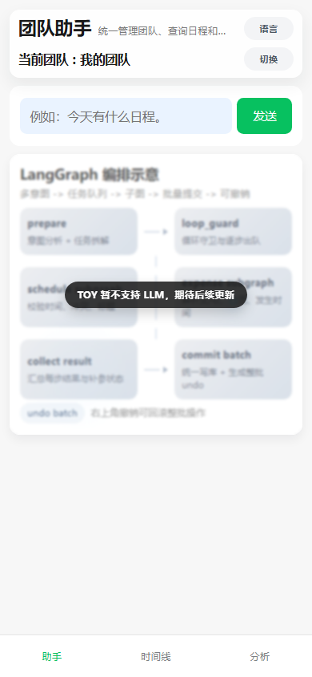
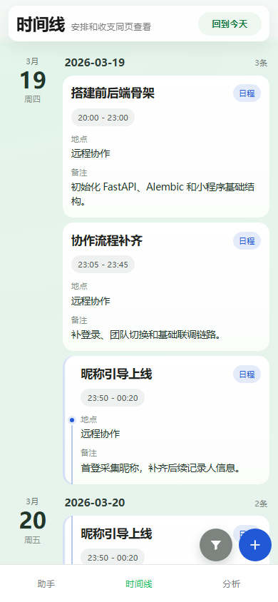
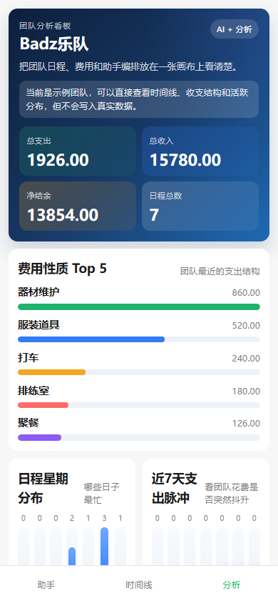

<h1 align="center">TeamHome</h1>

<h3 align="center">チームと家庭を、ひとつの場所で。</h3>
<p align="center">自然言語で予定や支出を作成・検索し、収支を記録。WeChat ミニプログラムで統合タイムラインを確認できます。</p>

<p align="center">
  <a href="#features">機能</a> · <a href="#assistant"><b>アシスタント</b></a> ·
  <a href="#install"><b>インストール</b></a> · <a href="#docs">ドキュメント</a> ·
  <a href="#support-teamhome">サポート</a>
</p>

<p align="center">
  <a href="../../LICENSE"></a>
  <a href="https://github.com/monkeyrs/teamhome/commits/main"></a>
  <a href="https://github.com/monkeyrs/teamhome/stargazers"></a>
  <a href="https://github.com/monkeyrs/teamhome/issues"></a>
</p>

<div align="center" dir="auto">
<a href="https://ko-fi.com/monkeyrs" rel="nofollow"></a>
</div>

<p align="center"><sub><a href="../../README.md">English</a> · <a href="README.zh-CN.md">简体中文</a> · <b>日本語</b></sub></p>

**無料・オープンソース・セルフホスト。** TeamHome はチームと家庭のためのコラボレーションツールです。共通タイムライン、自然言語アシスタント、収支の記録と分析、Excel エクスポートを備えています。バックエンドは FastAPI で自分自身で運用でき、フロントエンドは WeChat ミニプログラムです。ベンダーロックインはありません。

<table align="center">
  <tr>
    <td align="center"></td>
    <td align="center"></td>
    <td align="center"></td>
  </tr>
  <tr>
    <td align="center"><sub>アシスタント</sub></td>
    <td align="center"><sub>タイムライン</sub></td>
    <td align="center"><sub>分析</sub></td>
  </tr>
</table>

<a id="features"></a>

## 機能

| できること | 内容 |
| --- | --- |
| **アシスタント** | 自然言語で予定と支出を作成・検索します。 |
| **タイムライン** | 予定・収入・支出をひとつの画面で統合表示します。 |
| **分析** | チームのアクティビティや費用分布などの統計を表示します。 |
| **エクスポート** | チームデータを Excel 形式でダウンロードします。 |
| **チーム** | チームの作成・参加、チームパスワード、メンバー上限に対応します。 |
| **多言語** | 中国語・英語・日本語の UI テキストを i18n で管理しています。 |

<a id="assistant"></a>

## アシスタント

アシスタントは現在の開発の中心です。レガシーエンジンまたは **LangGraph** を選択でき、自然言語の解析には **OpenAI 互換**エンドポイントを利用できます。モデルの選択、フェイルオーバー、LangSmith によるトレースは環境変数で設定します。

どこから始めればよいか分からない場合は、Docker 構成で API、PostgreSQL、LangGraph 開発サーバーをまとめて起動できます。トレースの設定は [LangGraph デバッグドキュメント](../langgraph-debug.md) を参照してください。

<a id="install"></a>

## インストール

### Docker

リポジトリのルートで実行します。

```bash
docker compose up -d --build
```

本番環境では次を使用します。

```bash
docker compose -f docker-compose.prod.yml up -d --build
```

<details open>
<summary><b>バックエンドをローカルで実行</b></summary>

```bash
cd backend
pip install -r requirements.txt
cp .env.example .env
alembic upgrade head
uvicorn app.main:app --reload --host 0.0.0.0 --port 8000
```

利用前に `backend/.env` で `DATABASE_URL` や `JWT_SECRET` などを設定してください。サポートされているオプションは example ファイルに記載されています。

</details>

<details>
<summary><b>WeChat ミニプログラムを接続</b></summary>

1. WeChat DevTools で `frontend/` を開きます。
2. ローカル開発では `frontend/config/local.js` で API アドレスを上書きします。
3. ローカルデバッグ時は DevTools でドメイン検証を無効にします。

リポジトリ内はプレースホルダです：[frontend/config/default.js](../../frontend/config/default.js) の API アドレスは `https://your-domain.example/xcx`、`project.config.json` / `frontend/project.config.json` の AppID は `touristappid` です。ビルド・アップロード前に自分の値へ置き換えてください。

</details>

Windows では `scripts/start-backend.ps1` と `scripts/restart-backend.ps1` の利用を推奨します。

<a id="docs"></a>

## ドキュメント

- [ドキュメント一覧](../README.md)
- [開発履歴](../iteration-history.md)
- [オンボーディング内容](../onboarding-content.md)
- [アシスタント設計ベースライン](../assistant-ai-plan.md)
- [LangGraph デバッグ](../langgraph-debug.md)
- [デプロイガイド](../deployment.md)

## プロジェクト構成

- `backend/` — FastAPI、SQLAlchemy、Alembic、PostgreSQL。
- `frontend/` — WeChat ミニプログラム。
- `docs/` — 企画、デプロイ、デバッグ、イテレーションの資料。
- `scripts/` — 起動、再起動、文字コード検査、運用補助スクリプト。

## 開発ルール

- 画面文言はすべて i18n を通します。
- バックエンド構成を変更した場合は `scripts/` の起動・再起動スクリプトも更新します。
- ソースファイルは BOM なし UTF-8、JSON リクエスト / レスポンスは `charset=UTF-8` を明示します。
- 文字コード検査は `python scripts/ensure_utf8.py --check --root .`、修正は `python scripts/ensure_utf8.py --root .` です。
- 本番環境では `ASSISTANT_ENGINE=langgraph`、`ENABLE_DEBUG_ENDPOINTS=false`、`ALLOW_INSECURE_DEV_AUTH=false`、`ENVIRONMENT=production`、およびデフォルトではない強力な `JWT_SECRET` を確認してください。

<a id="support-teamhome"></a>

## TeamHome を支援する

TeamHome が役に立ったら、コーヒーで開発を支援できます。

<a href="https://ko-fi.com/monkeyrs" rel="nofollow"></a>

[GPL-3.0 ライセンス](../../LICENSE) · [問題を報告](https://github.com/monkeyrs/teamhome/issues)
